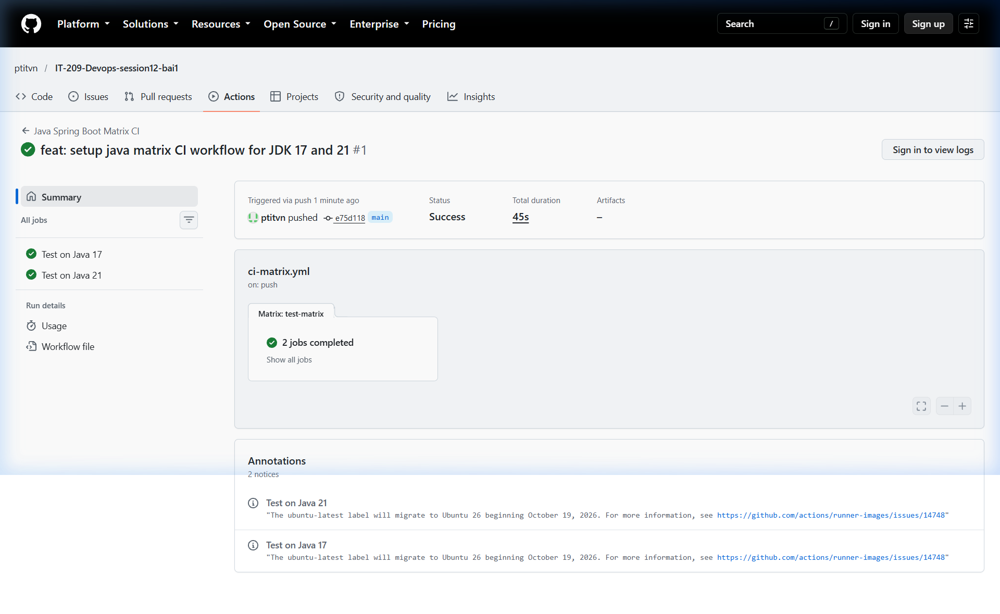
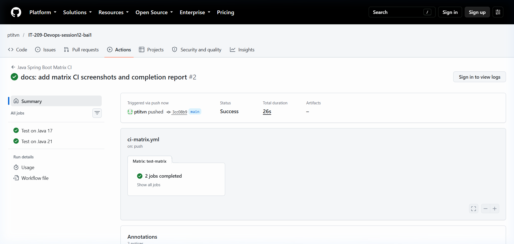
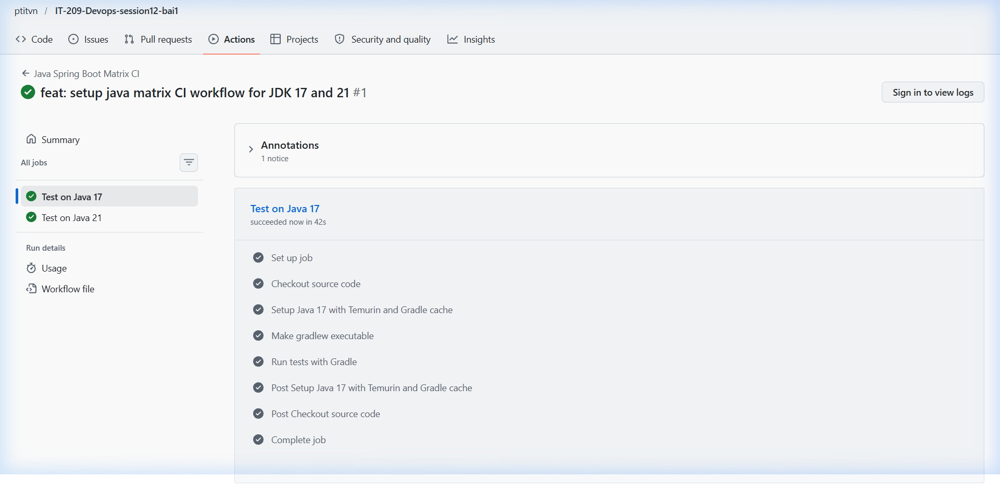
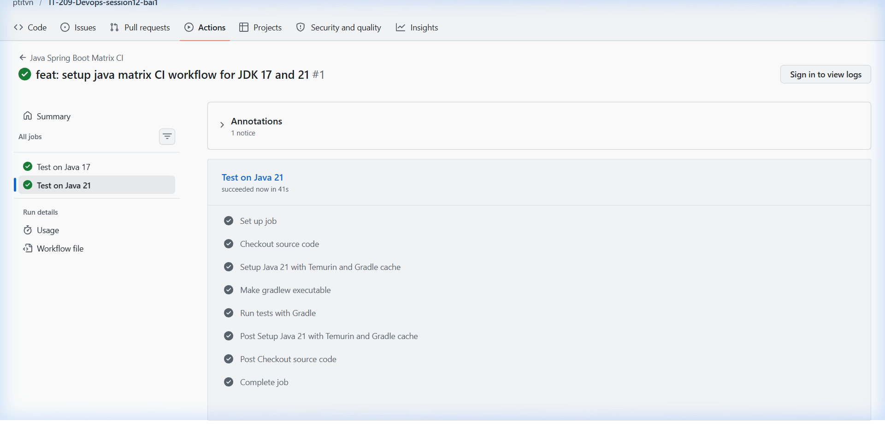
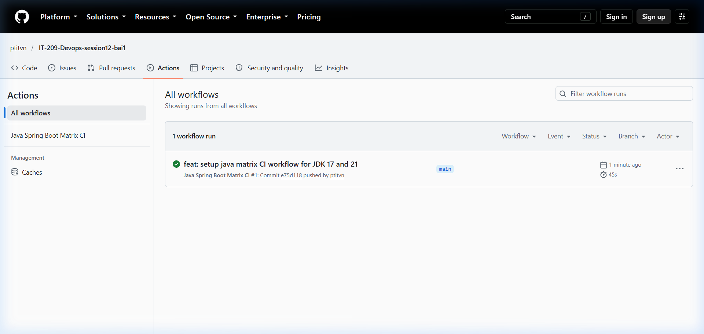

# BÁO CÁO BÀI TẬP - SESSION 12: BÀI 1

## Chủ đề: Xây dựng quy trình CI đa phiên bản JDK (Matrix Strategy) cho Java Spring Boot Gradle

---

## 1. Mục tiêu bài tập
- Cấu hình ma trận kiểm thử tự động (**Matrix Strategy**) trong GitHub Actions để chạy song song các bài unit test trên nhiều phiên bản JDK (**JDK 17** và **JDK 21**).
- Tối ưu hóa tốc độ thực thi ma trận với **Gradle Dependency Caching** thông qua `actions/setup-java@v5`.
- Đảm bảo tính tương thích của mã nguồn Java Spring Boot trên cả hai phiên bản LTS phổ biến nhất hiện nay.

---

## 2. Cấu hình kịch bản GitHub Actions Matrix Workflow

Tệp kịch bản được định nghĩa tại: `.github/workflows/ci-matrix.yml` và lưu trữ nộp bài tại `homework/session_12/ex1/ci-matrix.yml`.

```yaml
name: Java Spring Boot Matrix CI

on:
  push:
    branches: [ "main" ]

jobs:
  test-matrix:
    name: Test on Java ${{ matrix.java-version }}
    runs-on: ubuntu-latest
    strategy:
      matrix:
        java-version: ['17', '21']
    steps:
      - name: Checkout source code
        uses: actions/checkout@v5

      - name: Setup Java ${{ matrix.java-version }} with Temurin and Gradle cache
        uses: actions/setup-java@v5
        with:
          java-version: ${{ matrix.java-version }}
          distribution: 'temurin'
          cache: 'gradle'

      - name: Make gradlew executable
        run: chmod +x gradlew

      - name: Run tests with Gradle
        run: ./gradlew test
```

---

## 3. Phân tích kỹ thuật & Cơ chế hoạt động

### 3.1. Ma trận kiểm thử (Matrix Strategy)
- Khai báo `strategy.matrix.java-version: ['17', '21']` cho phép GitHub Actions tự động sinh ra **2 sub-job chạy song song**:
  - `Test on Java 17`: Runner khởi tạo môi trường Eclipse Temurin JDK 17 và thực thi `./gradlew test`.
  - `Test on Java 21`: Runner khởi tạo môi trường Eclipse Temurin JDK 21 và thực thi `./gradlew test`.
- Tên mỗi job được đặt động thông qua biến nội suy `${{ matrix.java-version }}` giúp quan sát trực quan trên giao diện GitHub Actions.

### 3.2. Tối ưu bộ nhớ đệm (Gradle Dependency Caching)
- Sử dụng thuộc tính `cache: 'gradle'` trong action `actions/setup-java@v5`.
- Cơ chế cache lưu trữ các tệp phụ thuộc (dependencies) trong `~/.gradle/caches` và Gradle Wrapper trong `~/.gradle/wrapper`.
- Khi các sub-job chạy, việc kích hoạt cache giúp giảm thiểu đáng kể thời gian tải thư viện từ Maven Central và giảm tải băng thông mạng.

---

## 4. Kết quả thực nghiệm trên GitHub Actions

- **Repository**: [https://github.com/ptitvn/IT-209-Devops-session12-bai1](https://github.com/ptitvn/IT-209-Devops-session12-bai1)
- **Workflow**: `Java Spring Boot Matrix CI`
- **Trạng thái**: **Success** (Tất cả các job đều hoàn thành thành công và có tích xanh).

### So sánh thời gian thực thi:
| Tiêu chí so sánh | Lần 1 (Tạo Cache mới) | Lần 2 (Khôi phục Cache Hit) | Mức độ cải thiện |
| :--- | :---: | :---: | :---: |
| **Run ID** | Run #1 (`e75d118`) | Run #2 (`3cc08b9`) | - |
| **Sub-job Test on Java 17** | 42s | 23s | **Giảm ~45%** |
| **Sub-job Test on Java 21** | 41s | 23s | **Giảm ~44%** |
| **Tổng thời gian Workflow** | **45s** | **26s** | **Giảm 19s (~42%)** |

---

## 5. Hình ảnh minh chứng

### 5.1. Tổng quan luồng Matrix Test trên GitHub Actions (Lần chạy 1)
Hiển thị job `test-matrix` tự động rẽ nhánh thành 2 sub-job chạy song song: `Test on Java 17` và `Test on Java 21`, cả 2 đều đạt tích xanh (Success).



---

### 5.2. Luồng Matrix Test với Cache Hit (Lần chạy 2 - 26s)
Thời gian hoàn thành giảm xuống còn 26s nhờ bộ nhớ đệm Gradle Cache.



---

### 5.3. Chi tiết các bước thực thi của Job "Test on Java 17"
Bao gồm đầy đủ các bước: Checkout mã nguồn (`actions/checkout@v5`), Thiết lập JDK 17 với Gradle Cache (`actions/setup-java@v5`), Cấp quyền Gradlew, Chạy kiểm thử Gradle JUnit.



---

### 5.4. Chi tiết các bước thực thi của Job "Test on Java 21"
Bao gồm đầy đủ các bước trên môi trường JDK 21, tất cả các bài test đều vượt qua thành công.



---

### 5.5. Lịch sử thực thi trong tab Actions
Danh sách workflow runs xác nhận trạng thái hoàn thành thành công trên nhánh `main`.



---

## 6. Kết luận
- Cấu hình Matrix Strategy thành công giúp kiểm thử ứng dụng đa phiên bản JDK hoàn toàn tự động, phát hiện sớm các vấn đề không tương thích giữa các phiên bản Java LTS.
- Việc thực thi song song rút ngắn thời gian phản hồi cho quy trình CI/CD.
- Tích hợp Gradle Cache tối ưu hóa hiệu năng tổng thể của pipeline (thời gian workflow giảm từ 45s xuống 26s).
